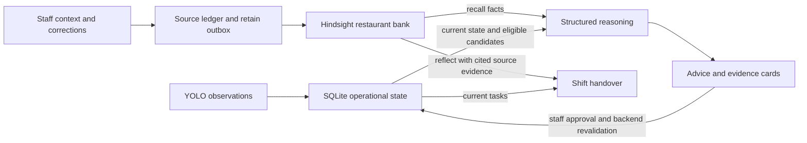

# Restaurant experience and shift supervision

The next shift benefits from what the last shift learned. This edition adds contextual seating, approved recovery actions, and memory-backed handover to the inherited vision/operations prototype.

## Run this edition

From `/Users/massgethu/CV_AI_Hindsight` run `./run_all.sh`. Open `http://127.0.0.1:5174/supervisor`; backend API documentation is at `http://127.0.0.1:8001/docs`. The original folder and its 8000/5173 servers are separate. Never configure this dashboard to use that backend.

Use **Floor Copilot** to start the controlled clip, pause during its initial vacant interval, confirm table cleanliness, and add a synthetic party of four. T2 and T3 both fit; fairness initially chooses T2. The footage is a labeled stock/blank montage, not natural multi-table CCTV.

## Human setup and secrets

Create an ignored `backend/.env` containing:

```dotenv
HINDSIGHT_BASE_URL=<API URL supplied by your Hindsight Cloud account>
HINDSIGHT_API_KEY=<your Cloud API key>
AGENT_API_KEY=<your Groq API key>
```

Restart **this edition's** backend after editing settings. `AGENT_MODEL` defaults to `openai/gpt-oss-120b`; `AGENT_BASE_URL` defaults to Groq's API. Other endpoints must support the same Groq-compatible endpoint paths and strict structured-response interface. The adapter accepts the Groq origin or a URL ending in `/openai/v1`, normalizing the latter for the SDK. Credentials never belong in a frontend variable or Git. Hindsight local endpoints can omit the Hindsight key if their own configuration permits it.

The service status distinguishes configuration from evidence of successful requests. `pending` means local source storage only. `retained` means Hindsight acknowledged processing; retrieval may become available later. Evidence panels show memories actually returned by Hindsight, never local-ledger search substituted for recall.

Participants must independently install and use Band AI according to the competition brief. This implementation does not install it, authenticate accounts, redeem credits, publish material, or claim Band AI usage.

## Walk through the experience loop

1. Confirm a **delivery rush** in Supervisor and describe staff availability. These are staff reports, not camera inferences.
2. Record a correction: during delivery rushes, T2 beside pickup causes interruptions; the manager reports preferring T3 when suitable. Choose T3 in the form. Capturing a note does not seat anyone.
3. Wait for its delivery status to become retained. Record a separate outcome as helped, did not help, or unknown. Clearly identify synthetic reports.
4. Start another logical shift. Floor, queue and tasks remain; temporary context resets to unknown. Reconfirm the current delivery rush.
5. Ask for advice with **Compare identical inputs with memory removed** selected. Inspect actual recalled evidence and the baseline versus memory-backed alternatives. Alternate seating is explicitly a manager policy choice.
6. Approve the proposed action. Every approval checks the original operational/context/memory revisions and current eligibility again. A changed state requires refreshed advice.
7. For recovery, create a dirty-table situation using ordinary staff/vision workflows. Ask which existing task prepares the remembered alternative. Approve priority and assignment separately, refreshing after each action. Staff must still complete cleaning.
8. Prepare a handover. Its historical synthesis uses Hindsight reflect; its current task list comes directly from SQLite.
9. Replace the lesson with a report that pickup moved. The old source, its outcomes, and advice-derived action evidence become historical. Ask again and inspect the changed evidence.

Restarting playback retains its inherited archive/reset behavior; it is distinct from starting a logical shift. Restarting the application preserves memory/source records but never restores visual freshness without observations.

## Data and trust boundaries



The ledger is stored separately from operational state in the same edition-owned SQLite file. It records original reports, provenance, relationships, delivery attempts and approval history. Restaurant banks isolate service data. Strict layout tags scope retrieval; layout identity includes video/configuration identity, table IDs, capacities and geometry. Region or capacity edits invalidate table-specific advice. Names alone are not identifiers.

Hindsight receives event-level source envelopes with stable IDs, timestamps, context and parent relationships. Outcome envelopes include the original episode so “helped” retains its meaning. The client configures extraction/reflection missions to distinguish reports, suggestions, approvals and outcomes, emphasizing durable operating lessons. Historical occupancy and hold facts can still be returned; they never determine current eligibility. Extraction-policy upgrades requeue the same source IDs and invalidate old advice. Current retrieval uses raw fact types with verifiable document provenance; unsupported consolidated sources are excluded.

The reasoner sees anonymous operational IDs, sizes, status, policy, role-compatible staff IDs, current context, and server-generated candidates. It does not receive footage, party names, roster names, party-linked table notes or operational task free text. Freeform staff notes must exclude customer identities. This is a local prototype with attributed staff inputs, not authenticated staff accounts.

Model output selects candidate IDs. The server derives action arguments, validates citations, rejects contradictory selections and checks eligibility again at approval. It never accepts model-supplied executable tools. Seating alternatives cannot displace another baseline party; this conservatively protects overdue parties as well. Assignment uses existing role checks. Priority is persisted as normal/high and shown in the staff desk. Neither the model nor memory can establish cleanliness.

Source supersession invalidates downstream outcome and advice-derived evidence. Historical reports remain visible. Conflicting outcome reports remain distinct rather than overwriting one another. Approval/rejection is never automatically counted as success.

When an agent-prioritized or assigned task later closes through operational workflows, the worker records that lifecycle event once, linked to its approved actions. Scenario-time timestamps are preserved. Completion or cancellation is an observed record, not a claim that the intervention improved service.

## Reliability and verification

One background worker delivers pending source records and coalesces operational/context changes into proactive advice. One generation lock covers advice and handover. Network requests never hold the operational lock. Obsolete replies are discarded. Retain uses at most three automatic attempts, stable document upserts, persisted retry status and an explicit retry control. Interrupted deliveries become pending on restart.

When services fail, normal deterministic operations stay available. Model/advice failures are visible and cannot execute actions. SDK errors are summarized without logging provider request bodies or credentials.

Run:

```sh
.venv/bin/python -m pytest backend -q --junitxml=docs/verification/hindsight-backend-junit.xml
cd frontend
npm test
npm run build
```

The supervisor tests explicitly inject fake services. They establish local contracts and invariants, not live Hindsight/LLM behavior. Browser verification of offline context, capture, feedback and logical shifts supplements these tests.

With this edition's backend running, `scripts/smoke_expanded.py` exercises actual YOLO on the controlled footage and writes a separately named Hindsight-edition report. It resets synthetic operational data in this edition.

After configuring credentials, run from the root:

```sh
.venv/bin/python scripts/evaluate_memory.py
```

This uses a distinct evaluation restaurant/bank and scratch database under this edition's data directory. It runs five same-input pairs, a quiet-period control, a later logical shift, restart recall, recovery priority/assignment, read-only reflect, and supersession. It writes service versions, retain receipts, actual retrieved facts, exact structured inputs, model responses and pass/fail checks. Its inputs are synthetic operational fixtures; it does not claim video inference or real business impact. There is no fake fallback. A missing-key report is explicitly not a passing live result.

The evaluator creates remote test memories in its named evaluation bank. It does not delete them automatically; preserve them as evidence or review deletion separately. No real customer data belongs in evaluation records.

## Limits and roadmap

The real-service evaluator passed five paired comparisons and all its control checks. Connected-service browser verification is recorded separately in the verification summary. The app has no real restaurant CCTV benchmark, trained departure predictor, visual intent detector, POS feed, staff authentication, external push notifications, or measured revenue/wait improvement. Memory adaptation changes supplied context; it does not train model weights.

After core live acceptance, the first stretch item is local Hindsight with edition-specific persistent storage and the same hosted model. Cloud/local switching must be explicit; no silent fallback. Further work includes a reviewed restaurant playbook, recurring visual-ambiguity guidance, and duration calibration supported by representative observations. These are roadmap items, not implemented features.

Upstream attribution, footage provenance and separate Ultralytics/model obligations remain in the inherited documentation. Pre-existing-code eligibility requires organizer clarification. Submission drafts are local and unpublished.
