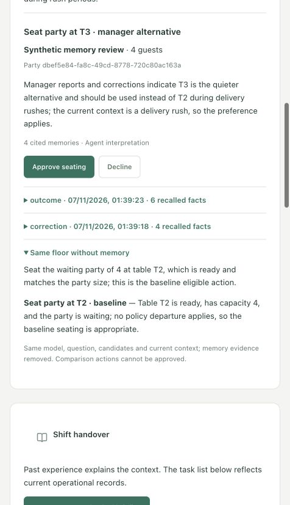

# Why Our Restaurant Agent Remembers Corrections With Hindsight

A restaurant manager can reject a perfectly valid seating recommendation for a reason the camera cannot see. We wanted the next shift to benefit from that explanation without making the manager repeat it.

That question shaped the memory layer in Restaurant Floor Copilot. The existing application already connects person detection, table readiness, a waiting queue, cleaning tasks, and explicit seating rules. We added operational experience: the conditions around a decision, the manager’s correction, the action taken, and any outcome staff subsequently reports.

This is a local implementation with synthetic demonstration inputs. Its automated service tests use explicit doubles. A separate evaluation using actual Hindsight and a hosted model passed five paired trials and its context, restart, recovery, handover, and supersession checks. That distinction matters because persisting a note locally does not establish that an agent retrieved or used it.

## A suitable table can still be a poor choice

Consider two four-seat tables and a waiting party of four. Both tables are clean, unoccupied, and eligible. A deterministic allocator can select a fitting table while respecting queue order and capacity. It has done its assigned job correctly.

Now add restaurant context. During a delivery rush, one table sits beside the pickup area. Staff reports that diners there experienced repeated interruptions. The manager chooses the other table and explains why.

The explanation contains information absent from occupancy data. It also has conditions. A report about the pickup rush should not permanently prohibit seating at that table during quiet service. If pickup later moves, the old lesson needs revisiting.

We made that sequence the core development scenario. Every operational report in the demonstration is labeled synthetic; the scenario illustrates the intended behavior rather than proving a restaurant outcome.



## Three responsibilities in the architecture

SQLite remains the source of current operational truth. It knows which party is waiting, whether staff confirmed cleanliness, which task remains open, and the current state version. Those facts determine whether an action is permitted.

[Hindsight’s persistent agent memory](https://github.com/vectorize-io/hindsight) supplies historical experience. We retain source records and recall relevant facts for the present situation. A hosted reasoning model receives those facts alongside current structured state and server-generated action candidates.

Finally, the application presents proposed actions and their evidence to staff. Approval triggers backend validation again. The model cannot invent a table identifier, complete a cleaning task, or bypass capacity checks through persuasive prose.

This separation gives memory a useful role without making historical notes authoritative about the present. An old report that a table was ready does not establish readiness now. A previous successful intervention may support a recommendation, but current eligibility still controls execution.

## Retain the reason and the surrounding episode

A correction record contains the original manager explanation, its source and timestamp, the current shift context, and relevant operational identifiers. We preserve the original source locally for audit and reliable delivery.

Each event receives a stable document identifier. Repeated delivery therefore updates the same Hindsight document rather than creating additional examples of the same experience. The client call includes explicit source context and a floor-layout tag:

```python
document_id=record["id"], timestamp=record["recorded_at"],
context=f"Restaurant shift operational {record['kind']}; source={record['source']}; situation snapshots are historical, never current table state",
metadata={"experience_id": record["id"], "layout_id": record["layout_id"]},
tags=[f"layout:{record['layout_id']}"], retain_async=False,
```

An outcome is a separate event linked to the original episode. “The manager approved it” and “staff later reported that it helped” are different claims. Unknown outcomes remain unknown.

Outcome records include their related experience so a short response such as “helped” keeps its meaning. We also retain negative and conflicting reports. Deleting the earlier report would hide information the next recommendation needs to consider.

## Recall experience for the current situation

The recall query includes the operational question, current context, and available candidates. Memory is partitioned by restaurant, while strict tags scope retrieval to the floor configuration.

```python
bank_id=self.bank_id, query=query, budget="mid", max_tokens=2400,
types=["world", "experience"],
tags=[f"layout:{layout_id}"], tags_match="all_strict",
```

The [Hindsight documentation](https://hindsight.vectorize.io/) explains the distinction between retention, retrieval, and reflection. Our action path uses retrieved facts that can be traced back to active source records. Read-only handovers use reflection to synthesize experience across shifts, with source evidence checked before display.

A retrieved fact must belong to this restaurant’s source ledger and current layout, and its source must still be active. We do not replace missing recall results with a local text search. If the service returns no relevant evidence, the application says so.

Layout identity includes table identifiers, capacities, and geometry. This deliberately makes table-specific experience conservative after configuration changes. Remembering “T2” is useful only while T2 still refers to the same operational setting.

## An approval boundary around the model

The reasoning response selects candidate identifiers rather than supplying executable tool arguments. Candidates cover seating, prioritizing an existing task, assigning an existing task, or taking no action.

Before acting, the backend checks the original proposal’s operational, context, and memory revisions. It then rebuilds eligibility. Changed conditions require new advice. The existing seating function still enforces readiness, freshness, party status, and capacity.

```python
if not any(c["id"] == candidate_id for c in self.candidates()):
    raise OperationError("The action is no longer eligible.")
```

Task priority and assignment are separately approved steps. Assigning a cleaner does not complete the task. Cleaning completion still requires the established staff confirmation workflow.

The memory-aware seating candidates are conservative: they exclude alternatives that would displace another party from the baseline allocation. That protects existing queue commitments while still allowing contextual table choices.

## Changing the lesson without losing history

Supersession became more interesting than storing another note. Suppose the pickup area moves. The earlier correction should become historical, but its influence can also survive indirectly through outcome reports and recorded action explanations.

We therefore track provenance relationships. Superseding a source also prevents dependent outcomes and advice-derived action evidence from reintroducing its old guidance. The timeline preserves the events and labels them historical.

This is where an [agent memory workflow](https://vectorize.io/what-is-agent-memory) becomes useful beyond a static preference field. The system needs the original conditions, later evidence, and changes in circumstances to remain distinguishable.

Logical shifts are also separate from video sessions. A manager handover should preserve current floor work. Starting a new shift resets temporary context to unconfirmed, while restarting playback retains the application’s explicit scenario-reset behavior.

## Keep service failures ordinary

Memory is a network dependency, so the interface needs to distinguish saving a source from retrieving an experience. A locally recorded correction starts pending. A background worker sends it with a stable identifier, records processing acknowledgement, and retries failures within a bounded policy. Retrieval can become available later than the write acknowledgement.

The floor continues operating while that happens. We avoid holding the operational lock during remote calls, and we discard generated advice if its input state has changed. A delayed response should never quietly become an instruction for a different queue.

The interface exposes pending delivery, failed delivery, missing evidence, and stale proposals. These states are useful operational information. They tell the manager whether the application has remembered the source remotely, found relevant evidence, or needs a fresh decision. An outage therefore leaves a visible gap in advisory capability while the existing deterministic controls remain usable.

## Testing the behavior change

Our evaluation harness compares identical structured floor inputs using the same model, question, current context, and action candidates. Only the retrieved memory evidence changes. The comparison path cannot execute actions.

The recorded evaluation passed five live pairs, a quiet-period control, recall after application restart, recovery prioritization and assignment, a sourced handover, and supersession. In each pair, memory changed the choice from T2 to T3; after the preference was retired, advice returned to T2. These repeated cases show consistency for this fixture, not general restaurant performance. It saves actual responses and service evidence. Without credentials, it reports that the evaluation did not run.

Local tests cover isolation, retries, invalid model selections, unsupported citations, conflicting outcomes, stale approvals, concurrent actions, and outages. Browser checks cover the manager-facing capture and shift workflows. These checks establish application behavior; they do not establish real-world restaurant accuracy or financial impact.

A connected browser check exposed an instructive failure: the model treated an old table hold as current. We reinforced current-state authority and added a historical-state distraction to the live evaluation. Another check caught a retired preference being misread, which led to validating the provenance behind seating overrides. These failures changed the implementation and remain recorded alongside the passing evidence.

The most useful lesson from this implementation is to preserve distinctions. Observation differs from interpretation. Approval differs from outcome. Historical experience differs from current state. Keeping those boundaries visible makes the memory easier to inspect, correct, and trust.
